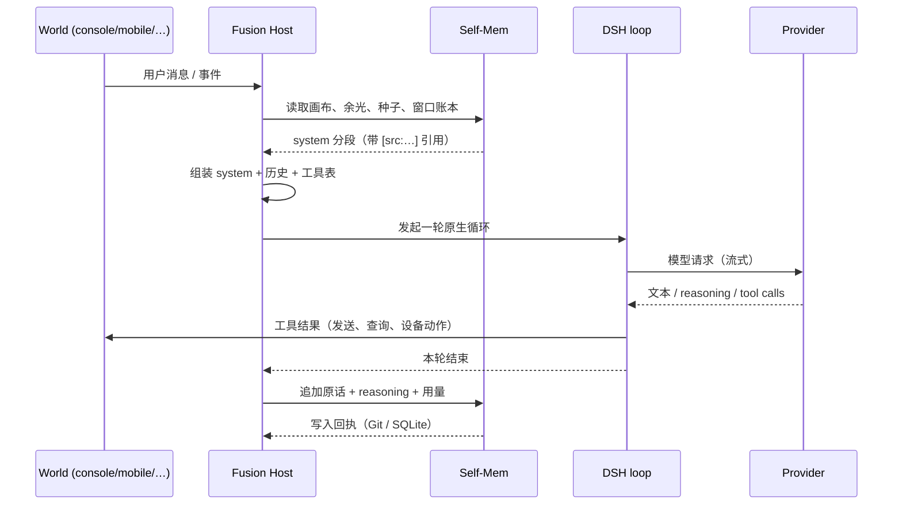

# 架构

## 1. 分层

```
┌──────────────────────────────────────────────────────────────┐
│ Worlds（通道层）                                              │
│ console · mobile · stt · tts · audio-play · canbot            │
│ codex-bridge · linux-tools · tinalink · tina-main-bot         │
├──────────────────────────────────────────────────────────────┤
│ Fusion Host（组合层）  src/                                    │
│  fusion-app      standalone 入口                               │
│  host-entry      Cordis 宿主插件入口                           │
│  fusion-launcher 进程守护 / 端口 / 生命周期                    │
│  fusion-world    World 注册、工具投影、事件                     │
│  fusion-prompts 系统提示词分段、可编辑文档、Persona 注入       │
│  fusion-context  压缩、交接、投影、预算                         │
│  fusion-ledger   轮次账本与用量                                 │
├──────────────────────────────────────────────────────────────┤
│ Self-Mem（记忆层）  self-mem/                                  │
│  sources.sqlite（只增原话） · Git 权威仓 · TINA_SELF.md        │
│  MCP / HTTP / session collector                                │
├──────────────────────────────────────────────────────────────┤
│ Cordis / DSH（原生运行时）  upstream/                          │
│  agent loop · session · tools · providers · compaction         │
├──────────────────────────────────────────────────────────────┤
│ Cortico（框架层）  upstream/cortico                            │
│  Bot API · World API · Web 控制台 · Extension 装载             │
└──────────────────────────────────────────────────────────────┘
```

Fusion Host 不重写上游，而是**在同一个进程里**把三套能力接起来：

1. Cortico 负责 Bot、World、Web 与插件生命周期；
2. DSH 负责原生 Agent 循环、工具调用、会话与压缩；
3. Self-Mem 作为 `@tina/self-mem` Bot 接管人格文档与长期记忆。

## 2. 进程与入口

| 入口 | 文件 | 用途 |
| --- | --- | --- |
| standalone | `src/fusion-app.mjs` → `openFusionApp()` | 独立起一个 Tina 进程，自带 Web 控制台 |
| launcher | `src/fusion-launcher.mjs` → `launchFusion()` | 读取部署配置、准备目录、启动并守护 |
| Cordis plugin | `src/host-entry.mjs` → `mountHostPlugin()` / `apply()` | 挂进已有的 Cordis/DSH 宿主，共享会话与 Provider |
| native session | `src/dsh-native-session.mjs` | 把原生会话接到融合上下文策略 |

`package.json` 的 `exports` 把上述入口逐一暴露，宿主可以只引入需要的一层。

## 3. 一轮请求的流向



要点：

- **World 只负责「怎么收发」**，不拥有上下文；同一份会话可以换通道继续。
- **发送是显式动作。** 模型正文默认是内部心音；要真正到达用户，必须调用当前通道的发送工具（`console_send`、`coo_mobile_reply`、`pet_say` 等）并拿到回执。
- **原话与 reasoning 分开存。** 只记录服务端真实返回的内容，不推测未返回的内部推理。

## 4. 提示词组装

`src/fusion-prompts.mjs` 把 `system` 拆成可寻址的分段，统一注册、可编辑、可重置：

| 分段来源 | 说明 |
| --- | --- |
| 原生 DSH 段 | 上游默认系统提示词，可按段覆盖 |
| 部署文档 | `deployment/prompts/*.md`（本仓库只提供模板） |
| Persona 文档 | `selfMem.canvas`（`TINA_SELF.md`）与 `selfMem.seed` |
| World 环境段 | 每个 World 的 `envPrompt` |
| 工具指南 | 按需装入的 `ref:guide`、窗口账本 |

分段有稳定的 key 与顺序；覆盖写入 `fusion-section-overrides` 设置命名空间，冲突通过 `PromptRevisionConflict` 拒绝，避免两个窗口同时改写。

## 5. 上下文策略

`src/fusion-context-policy.mjs` 负责把配置翻译成运行时约束：

```json
"context": {
  "maxTokens": 300000,
  "keepRatio": 0.15,
  "softRatio": 0.85,
  "firstTurn": false
},
"loop": { "softCap": 44, "hardCap": 52 }
```

- `softRatio`：达到该比例开始准备压缩；
- `keepRatio`：压缩后保留的近期窗口比例；
- `softCap / hardCap`：单轮工具循环的软/硬上限；
- 压缩前由 `prepareContextHandoff` 捕获原文与导航，确认原生 surface 已持久提交后才允许裁剪；不确定时 `complete=false`，原文仍然保留。

`src/fusion-context-maintenance.mjs`、`fusion-context-runtime.mjs`、`fusion-projection.mjs` 分别处理维护、运行时预算与投影。

## 6. World 接口

每个 World 是一个独立包，至少导出：

```js
export default {
  id: 'example',
  label: 'Example World',
  defaults: () => ({ enabled: false }),
  create: (context) => new ExampleWorld(context),
  describe: { tools: [...], events: [...] },
};
```

World 可以声明：

- `tools`：暴露给模型的工具 schema；
- `events`：向宿主推送的事件类型与触发方式；
- `envPrompt`：注入 system 的环境说明；
- 配置模式：由 Web 控制台渲染，支持热更新标记 `x-hot`。

本仓库内置的世界见 `worlds/`，安装方式见 [`DEPLOYMENT.md`](DEPLOYMENT.md)。

## 7. 端口与监听

默认全部只监听回环地址：

| 服务 | 端口 | 配置键 |
| --- | --- | --- |
| Web 控制台 | 7789 | `web.port` |
| Mobile World | 7799 | `worlds.mobile.port` |
| Tinalink（主/备） | 7801 / 7802 | `worlds.tinalink.port` |
| Work Agent 桥 | 3095 | `worlds.workagent.endpoint` |
| Self-Mem HTTP | 8895 | `selfMem.memoryIngress.port` |
| Coo Mobile | 7803 | `worlds.coo_mobile.port` |
| Desktop Pet | 17997 | `worlds.desktop-pet.port` |
| Canbot 上行/语音 | 7333 / 7334 | `worlds.canbot.*` |
| STT / TTS | 8010 / 8042 | `worlds.stt.baseUrl` / `worlds.tts.baseUrl` |

对外暴露时应放在反向代理之后并启用 TLS；不要直接把 7789 开到公网。

## 8. 状态与目录

运行时的状态与代码分离：

```
<deployment>/
├── config.json          # 部署配置（含密钥引用，不提交）
├── .env                 # 环境变量（不提交）
├── data/                # 会话、媒体、用量、运行记录
├── workspace/           # 工作区
├── providers/           # Provider 配置
├── extensions/          # World / Bot 的安装树
└── self-mem/            # 记忆库（authority / replica）
```

代码在 `releases/<version>/`，升级时新建候选目录、切换 systemd `ExecStart`，保留旧版本以便回滚。

## 9. 延伸阅读

- [`MEMORY.md`](MEMORY.md)：记忆模型与六个工具
- [`DEPLOYMENT.md`](DEPLOYMENT.md)：从零搭建
- `ops/README.md`：被动采集与归档的边界
- `self-mem/README.md`：记忆引擎的完整设计说明
