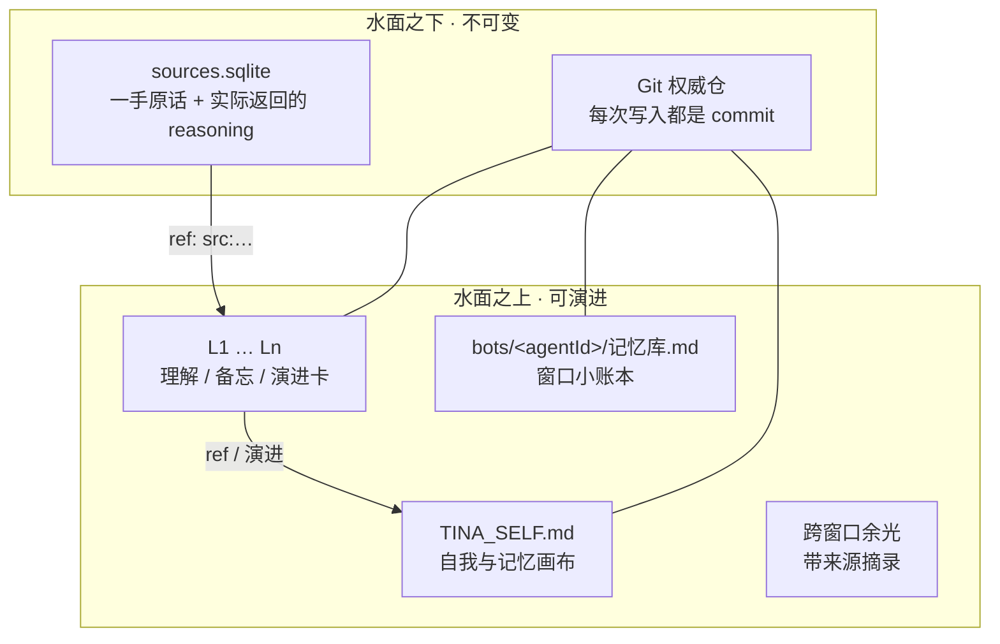

# 冰山记忆模型

> 看得见的是回答，看不见的是原话。  
> **冰山不是比喻，是存储结构。**

Tina 的记忆分成两层：水下不可变的一手原话，水面上可演进的自我认知。两者用 `[src:…]` / `[note:…]` 互相引用，但从不混写。

## 1. 水下：L0 原话

- 存在 `sources.sqlite`，表 `sources(sourceId, record, digest)`。
- `UPDATE` / `DELETE` 被 SQLite 触发器直接 `ABORT`。
- 记录来源通道、Agent 位置、会话、时间、角色、正文，以及**服务端实际返回**的 reasoning。
- 纠错不是改旧行，而是追加新记录，并保留旧来源。

这层回答的是：**当时到底说了什么？**

## 2. 水面：L1…Ln 理解

- 理解、摘要、备忘、演进卡存在 Git 权威仓。
- `rewrite` / `evict` 自动生成「原表述 / 新表述 / 缘由」演进卡。
- 每次写入都有 revision，并发写用 CAS 拒绝，不静默覆盖。
- `mem_read` 可以按 `rev` 读回任意历史版本。

这层回答的是：**我现在怎么理解它？**

## 3. 四件常驻物

| 名称 | 位置 | 作用 |
| --- | --- | --- |
| **画布** | `TINA_SELF.md` | 第一人称自我认知、主线、模糊印象；默认上限 16,000 字 |
| **余光** | 动态生成 | 其他窗口最近对话的带来源摘录；摘录 ≠ 已读 |
| **账本** | `bots/<agentId>/记忆库.md` | 当前窗口的任务进度、检验结论、避坑点 |
| **备忘** | `entries/*.md` | 不常驻画布的长篇细节与演进卡 |

## 4. 三条纪律

1. **一件事实只存一处。** 原文在 L0，理解在 L1…Ln；不在两个地方各写一份。
2. **只增不改。** 新记录追加，旧记录保留；纠错用新记录引用旧记录。
3. **证据边界。** 读到、检索到、写入成功、模型实际使用，是四件不同的事；回执只证明它声明的那一步。

## 5. 为什么是 Git + SQLite

- SQLite 擅长**只增、按 ID 取、全文检索、事务**；
- Git 擅长**版本、diff、并发冲突、历史回滚**；
- 两者分工：原话进 SQLite，理解进 Git；引用把两边连起来。

这不是“向量库换皮”。向量检索只是召回手段之一；**可追溯的原话与可回滚的理解**才是底座。

## 6. 和 Self-Mem 的关系

冰山模型是 `@tina/self-mem` 的存储与认知设计；Self-Mem 是它的实现：

- 六个工具：`self_memory_read` / `self_memory_patch` / `mem_search` / `mem_read` / `mem_ledger` / `mem_note`
- MCP / HTTP / Cortico Bot 三种接入
- 包与源码：[`self-mem/`](../self-mem/) · [Release](https://github.com/rtmhjx/tina-foundation/releases)

## 7. 边界

- `scope` / `legacyScope` 是检索过滤，**不是权限边界**。
- 删除记忆不是删一行：权威仓、副本、备份、索引要一起处理。
- 画布与账本会包含个人信息；部署时放受保护目录，不进代码仓。
- 这是研究型工程，不承诺长期稳定性。
