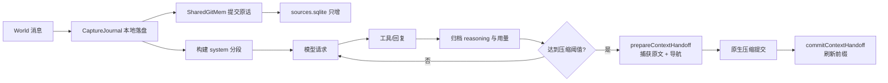

# 记忆模型

Self-Mem 解决的不是“存聊天记录”，而是**同一个 Agent 在多个窗口、多个设备、多次重启之后仍然是同一个**。它把「原话」与「理解」分开：原话不可变，理解可演进。

## 1. 两层存储

```
<memoryDir>/
├── authority/                  # 唯一权威仓（Git）
│   ├── sources.sqlite          # 只增原话 + 同步游标
│   ├── entries/                # 备忘、认知演进卡（markdown）
│   ├── bots/<agentId>/记忆库.md  # 每个窗口的任务小账本
│   ├── TINA_SELF.md            # 自我与记忆画布
│   ├── SEED-TAIL-PROACTIVE-GITMEM.md
│   ├── 记忆分层与升格说明书.md
│   └── .git/
└── replica/
    └── workspaces/<agentId>/   # 各窗口的本地镜像与工作副本
```

### `sources.sqlite`

```sql
CREATE TABLE sources (
  sourceId TEXT PRIMARY KEY,
  record   TEXT NOT NULL,   -- 原始记录（JSON）
  digest   TEXT NOT NULL
);
CREATE TRIGGER sources_immutable_update BEFORE UPDATE ON sources
  BEGIN SELECT RAISE(ABORT,'immutable source'); END;
CREATE TRIGGER sources_immutable_delete BEFORE DELETE ON sources
  BEGIN SELECT RAISE(ABORT,'immutable source'); END;

CREATE TABLE sync_state (
  authority    TEXT PRIMARY KEY,
  localCursor  INTEGER NOT NULL,
  remoteCursor INTEGER NOT NULL
);
```

- **只追加**：更新与删除被触发器拒绝。纠错不是改旧行，而是追加新记录并在阅读时保留来源。
- `record` 保存来源通道、Agent 位置、会话、时间、角色、正文与实际返回的 reasoning。
- 多份投影共享同一个原生事件引用；流式临时片段不写入原文。
- `sync_state` 只记录副本与权威仓之间的游标，不是第二份原文。

### Git 权威仓

`TINA_SELF.md`、`bots/<agentId>/记忆库.md`、`entries/*.md` 都在同一个 Git 仓库里。每次写入是一次 commit：

- 并发写用 `expectedRevision` / Git CAS 保护，冲突明确拒绝，不静默覆盖；
- `rewrite` / `evict` 自动把「原表述 / 新表述 / 缘由」写成演进卡，旧版本仍在历史里；
- 任何窗口都能用 `mem_read` 指定 `rev` 读回历史版本。

## 2. 六个工具

| 工具 | 作用 | 关键边界 |
| --- | --- | --- |
| `self_memory_read` | 读最新画布 + 跨窗口近期余光 | `refreshSystem:true` 只申请下一轮刷新，不保证宿主支持 |
| `self_memory_patch` | `promote` / `rewrite` / `evict` 画布 | 自由标题；`rewrite` 留演进卡 |
| `mem_search` | 在全部原话与备忘中检索 | 返回 `[src:…]` / `[note:…]`；`includeReasoning` 可选 |
| `mem_read` | 按引用读原话、备忘、画布、指南、种子、账本 | `includeNeighbors` 最多前后各 40 条 |
| `mem_ledger` | 读写本窗口任务账本 | `expectedRevision` 并发保护 |
| `mem_note` | 写入长期归档备忘 | 同一 `noteId` 可演进新版本 |

`ref:seed` 的读取顺序：权威仓里的种子优先，包内 `presets/` 只是回退。公开仓库不附带任何真实人格种子。

## 3. 画布、余光、种子、指南、账本

- **画布 `TINA_SELF.md`**：第一人称、自由结构，默认上限 16,000 字。它承载清晰自我认知，也允许带 `[src:…]` 的模糊印象。超过上限会拒绝写入并提示先收进冷库。
- **跨窗口余光（Lifecycle Pulse）**：新会话或显式刷新时，附上其他窗口最近对话的**摘录**与引用。摘录不是已读，也不代表已核实。
- **种子 `SEED-TAIL-PROACTIVE-GITMEM.md`**：部署者提供的主动性与记账约定。公开仓库里是中性模板。
- **指南 `记忆分层与升格说明书.md`**：L0 原文 → L1…Ln 理解的升格方法。`mem_read` 传 `ref:guide` 读取。
- **窗口账本 `bots/<agentId>/记忆库.md`**：只属于当前窗口的进度、检验结论与避坑点。每次修订进 Git。

`scope` / `legacyScope` 只是**检索过滤**，不是访问控制；真正的隔离来自部署边界与令牌。

## 4. 生命周期



关键点：

- **先落盘再提交**：本地 intake 先保证原话不丢，再写权威仓。
- **压缩不等于记忆**：压缩只处理当前 `system` 现场；原文仍在 L0。交接回执只证明“已捕获”，不证明语义完整。
- **前缀冻结**：同一会话的 L0 前缀保持字节稳定，动态余光与账本走尾部注入，避免破坏 Provider 缓存。
- **崩溃恢复**：未确认的写入保持 pending，重启后按原 operation ID 对账，不换 ID 重发。

## 5. HTTP 与 MCP

```bash
# HTTP（默认 8895，或 --port 指定）
node self-mem/src/http-server.mjs --dir /path/to/memory --port 8895

# MCP（stdio）
node self-mem/src/mcp-server.mjs --dir /path/to/memory --agent codex
```

HTTP 端点：

| 方法 | 路径 | 说明 |
| --- | --- | --- |
| `GET` | `/api/system-block` | 画布 + 可选种子/指南/账本/余光；`includeSeed`、`includeGuide`、`includeLedger`、`ledgerAgentId` |
| `GET/POST` | `/api/ledger` | 读/写窗口账本 |
| `GET` | `/v1/self` | 历史兼容的自我视图 |

跨设备时服务端用 `TINA_SELF_MEM_TOKEN` 做 Bearer 认证；MCP 客户端用 `--remote-url` 与 `--remote-token`。

## 6. 隐私边界

- 原话库是**内容**，不是底座。公开仓库不包含 `sources.sqlite`、画布、种子或账本。
- `entries/`、`bots/` 与画布都可能包含个人信息；部署时放在受保护目录，不进入代码仓。
- 备份必须用 SQLite 在线一致性快照或停机复制，不能单拷 `sources.sqlite` 主文件当作完整备份。
- 删除记忆不是“改一行”：需要同时处理权威仓、副本、备份与检索索引，并保留可审计的回执。
